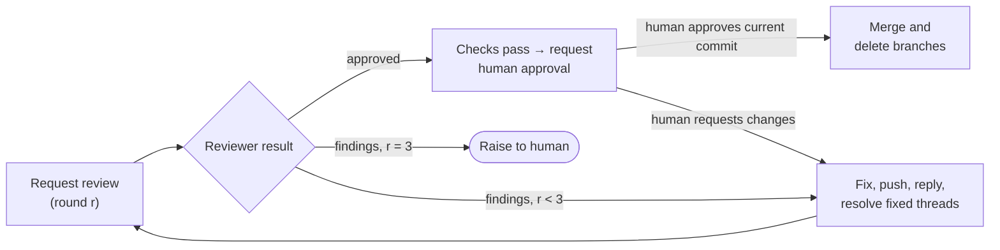

# PR review

## Contents

- [Reviewer](#reviewer)
- [Autonomy](#autonomy)
- [Project settings](#project-settings)
- [Preconditions](#preconditions)
- [Slack thread](#slack-thread)
- [The loop](#the-loop)
- [Requesting a review](#requesting-a-review)
- [Fixing the feedback](#fixing-the-feedback)
- [Human approval](#human-approval)
- [Merging](#merging)
- [Raising to the human](#raising-to-the-human)
- [Rules](#rules)

## Reviewer

The reviewer is an external tool, separate from Claude. Only this section and the command in [Requesting a review](#requesting-a-review) name it; the rest of the skill holds for any reviewer.

| Setting | Current value |
| :--- | :--- |
| Tool | Codex CLI |
| Model | `gpt-6.1-sol`, or the nearest equivalent if it is unavailable |
| Effort | high |

To change the reviewer, update this table and the command; keep the [review prompt](#review-prompt) as is.

`--approve-for-me` routes the reviewer's approval requests, such as its Slack reply, through automatic review in the workspace-write sandbox. It cannot be combined with `-s`/`--sandbox`.

## Autonomy

Creating the PR starts this skill; Claude does not ask whether to begin. Claude drives review and fixes — request, wait, fix, push, reply, resolve, re-request — autonomously. This skill is the human's standing authorisation for those pushes, comments, thread resolutions, and the Slack posts and reactions in [Slack thread](#slack-thread). Merging requires separate, explicit human approval through [Human approval](#human-approval); this skill does not authorise an automatic merge.

- Wait for the background reviewer run's completion notification; do not poll it and do not hand back to the human while it runs.
- Pause at the mandatory [Human approval](#human-approval) gate, or stop for a reason listed in [Raising to the human](#raising-to-the-human). Anything else — a failing test, a finding to fix, a re-review to request — Claude handles itself.
- Report when ready for human approval, then report the final outcome: merged, changes requested, or raised.

## Project settings

The project's instructions (its `CLAUDE.md`, or a file it points to) give the values below; this skill holds none of them.

| Setting | What the project gives | When the project gives none |
| :--- | :--- | :--- |
| Reviewer App | The GitHub App the reviewer posts as (`<app>[bot]`), and the directory holding its `app-id` and `private-key.pem` | Review [without an App](#reviewer-identity) |
| PR channel | The Slack channel where the project's PRs are mirrored: its name and ID | No [Slack thread](#slack-thread) |
| Slack language | The language of Slack messages | English |
| Bot user | The Slack user ID of the bot account Claude and the reviewer post as | In [Human approval](#human-approval), ask the human directly instead of reading Slack replies |

A project with its own review skill follows that skill for posting and approving, not this one; it may still borrow `slack-post.sh` and `slack-upload.sh`.

## Preconditions

- The work is committed and pushed, and the PR is open. Note its number `<N>`, its branch, and its base branch.
- The working tree is clean and on the PR branch.

### Reviewer identity

Every reviewer comment starts with the marker `**[PR review]**`, whoever posts it. How the reviewer posts and approves depends on whether the project's [settings](#project-settings) name a reviewer App:

- **With an App.** The reviewer prefixes every `gh` command with `GH_TOKEN=$(~/.claude/skills/pr-review/reviewer-gh-token.sh <owner>/<repo> <App config directory>)`, which mints a one-hour token for the App, so it posts as the App. Its approval is a GitHub approving review (`gh pr review <N> --approve`). Branch protection requires that approval and dismisses it on any new push, so the reviewer's approval is enforced by GitHub, not only by this skill. Whichever tool is the reviewer, Codex or Claude, uses the App; the author session never runs the script.
- **Without an App.** The reviewer posts with the same GitHub account as Claude, so its approval is a marked PR comment, not a GitHub review: GitHub does not let an account approve its own PR.

## Slack thread

Every PR gets one Slack thread in its project's PR channel, the official place the team follows PRs. A project whose [settings](#project-settings) name no PR channel has no thread; skip this section's steps for it.

Claude and the reviewer post every message as the project's bot user, so it shows as unread to the human: `~/.claude/skills/pr-review/slack-post.sh <channel ID> [<thread ts>] < <message file>`, which takes standard Markdown and prints the message's `ts`. A file such as a screenshot goes to a thread with `~/.claude/skills/pr-review/slack-upload.sh <channel ID> <thread ts> <file> [<comment>]`; start a comment with the marker. Reading and reactions stay with the Slack tools. Sharing the bot account, their messages carry the same kind of marker as on GitHub: Claude's start with `[Claude]`, the reviewer's with `[PR review]`. Both write their Slack messages in the project's Slack language, keeping markers, `APPROVED`, links and commit SHAs unchanged. GitHub comments stay as they are.

| When | Who | What |
| :--- | :--- | :--- |
| The PR is created | Claude | Posts the main message in the channel: `[Claude] PR #<N>: <title>`, the PR link, `<branch> → <base>`, then the text of the PR description's **Summary** section in the message body. Notes its timestamp `<thread ts>`. |
| Each review round finishes | Reviewer | Replies in the thread with the round summary (see the [review prompt](#review-prompt)). |
| A round's fixes are pushed and their threads resolved | Claude | Adds a `white_check_mark` reaction to that round's summary message. |
| Ready for human approval | Claude | Adds an `alarm_clock` reaction to the main message, then replies in the PR thread with the PR link, current head SHA, review and check results, and that merging awaits explicit human approval. The reaction stays after the merge; the `white_check_mark` is what shows the PR merged. |
| The PR is merged | Claude | Adds a `white_check_mark` reaction to the main message. |

When resuming a PR, find its main message by searching the channel for the PR link before posting; never post a second main message for the same PR. If a Slack call fails, retry once, then carry on with the review and mention the gap in the final report; Slack trouble alone never stops review or fixes, and never bypasses the human gate; request approval directly in the session if Slack is unavailable.

## The loop



A round is one review. At most three rounds run. A round-3 review that still has findings goes to the human, not to another fix.

## Requesting a review

Write the [review prompt](#review-prompt), filled in with round `r`, PR `<N>`, `<owner>/<repo>`, the App config directory and the Slack channel ID, `<thread ts>` and Slack language (drop the Slack paragraph for a project with no [Slack thread](#slack-thread)), to a prompt file. Keep the `[With an App]` lines for a project with a [reviewer GitHub App](#reviewer-identity) and the `[Without an App]` lines otherwise, dropping the brackets. Then run the reviewer from the repository root, in the background (a high-effort review takes minutes). With Codex:

```bash
codex exec -m gpt-6.1-sol -c model_reasoning_effort='"high"' --approve-for-me \
  -c sandbox_workspace_write.network_access=true \
  -o <scratchpad>/pr-review-<N>-r<r>.md - < <scratchpad>/pr-review-<N>-r<r>-prompt.md
```

When it finishes, read the output file, then confirm the outcome on GitHub: the approval exists, or the round-`r` review and its inline comments do. With an App, the approval is the App's approving review on the current head: `gh pr view <N> --json reviewDecision,latestReviews,headRefOid` shows `reviewDecision` `APPROVED` and the App's latest review `APPROVED` at `headRefOid`. Without an App, it is the approval comment. If the reviewer failed or posted nothing, rerun the same round once; if it fails again, raise to the human. Also read the Slack thread and note the `ts` of the round-`r` `[PR review]` reply; if it is missing, say so in the final report rather than rerunning the round.

### Review prompt

```text
You are reviewing GitHub PR #<N> in this repository, round <r> of at most 3.
[With an App] Run every `gh` command, including `gh api`, as
[With an App] `GH_TOKEN=$(~/.claude/skills/pr-review/reviewer-gh-token.sh <owner>/<repo> <App config directory>) gh ...`,
[With an App] so you post as the reviewer App.
Read the PR with `gh pr view <N>` and `gh pr diff <N>`, and the surrounding code as needed.
On rounds 2 and 3, first read the earlier review comments and Claude's replies
(`gh api repos/{owner}/{repo}/pulls/<N>/comments`, `gh pr view <N> --comments`) and
check each earlier finding is fixed or convincingly answered. Threads Claude resolved
are ones it says it fixed: verify the fix, and if it is inadequate raise a new inline
comment. Threads left unresolved are ones Claude disputed: if its reasoning convinces
you, resolve the thread (GraphQL `resolveReviewThread`); otherwise reply in the thread
and keep it as a finding.

Review for correctness, security, missed requirements, and maintainability. Do not edit
code, commit, or push.

If you have findings: submit ONE review with inline comments through
`gh api repos/{owner}/{repo}/pulls/<N>/reviews` with `event: "COMMENT"` and a
`comments` array. Each comment sets `path`, `line` (and `start_line` for a range),
`side: "RIGHT"`, and a body that starts with `**[PR review]**`, cites the source
lines it is about, states the problem, and proposes the fix. The review body starts with
`**[PR review]** Round <r>:` and summarises the findings.

If you have no findings, approve with a body that is exactly
`**[PR review]** APPROVED: PR #<N> is fully reviewed and approved (round <r>).`
[With an App] Submit it as an approving review: `gh pr review <N> --approve --body '<body>'`.
[Without an App] Post it as a PR comment: `gh pr comment <N> --body '<body>'`.

Then reply in Slack by piping the reply to
`~/.claude/skills/pr-review/slack-post.sh <channel ID> <thread ts>`, never as a new channel
message and never with your Slack tools. The reply starts with
`[PR review] Round <r>:` and gives either `APPROVED` or the finding count with a one-line
summary of each finding, plus a link to the GitHub review or approval comment. Write the
reply in <Slack language>, keeping the marker, `APPROVED` and the link unchanged.

Finish by printing either `APPROVED` or `CHANGES REQUESTED: <count> findings`.
```

## Fixing the feedback

For every `**[PR review]**` inline comment of the current round:

1. Fix the cited code, or, if the finding is wrong, decide not to change it.
2. Commit the fixes (one commit per round is fine) and push to the PR branch.
3. Reply in each comment's thread
   (`gh api repos/{owner}/{repo}/pulls/<N>/comments/<id>/replies -f body=...`): the commit that fixed it, or the reasoning for not changing it. The reviewer judges that reasoning in the next round.
4. Resolve the thread of every comment that was fixed and pushed. Leave a thread Claude disputed unresolved; the reviewer resolves it if convinced.
5. Add a `white_check_mark` reaction to the round's `[PR review]` summary in the [Slack thread](#slack-thread).

Run the project's tests and checks before pushing. Then request the next round.

### Resolving threads

Review threads are resolved through GraphQL, by thread node ID. List the threads and match each to its comment by `databaseId` (the REST comment `id`):

```bash
gh api graphql -F owner=<owner> -F repo=<repo> -F n=<N> -f query='
  query($owner:String!,$repo:String!,$n:Int!){repository(owner:$owner,name:$repo){
    pullRequest(number:$n){reviewThreads(first:100){nodes{
      id isResolved comments(first:1){nodes{databaseId}}}}}}}'
```

Then resolve each fixed one:

```bash
gh api graphql -f id=<thread node id> -f query='
  mutation($id:ID!){resolveReviewThread(input:{threadId:$id}){thread{isResolved}}}'
```

## Human approval

After the reviewer approves the latest commit, confirm the PR is mergeable, its checks pass, and no review thread remains unresolved. Then present the human with the PR link, current head commit SHA, change summary, reviewer approval link and rounds run, test/check results, and any material limitations. Ask explicitly whether to merge that PR at that commit, and pause.

While paused, watch for the human's answer, so a reply in Slack or on GitHub needs no nudge:

- Right after asking, schedule a recurring check with `CronCreate`, every 3 minutes, whose prompt names the PR, the head SHA, the [Slack thread](#slack-thread) and this section. Each check reads the replies in the Slack thread and the PR's GitHub comments since the request. If there is nothing new, end the turn without posting or reporting anything.
- A reply is the human's when it has no `[Claude]` or `[PR review]` marker and, in Slack, is not from the project's bot user and has no "Sent using" footer. If that leaves any doubt, ask the human directly; do not merge.
- Delete the check with `CronDelete` once the human has answered, the PR is closed, or its head changes; a new request schedules a new check.
- The check lasts only as long as the session and expires after 7 days. If it cannot be scheduled, say in the request that a reply in Slack or on GitHub needs a nudge.

Answers count as follows:

- Accept only the human's own explicit approval for this PR and commit, given after this request in the session or directly in the PR's GitHub or Slack thread. Approval in response to a request that names the SHA applies to that SHA; the human need not repeat it.
- Reviewer approval, an agent's relayed claim of approval, a reaction, silence, and earlier instructions to implement or open a PR do not satisfy this gate. Since agents may share the human's account, account identity alone is not proof: verify the approval came directly from the human.
- The one exception is a relay the project's own instructions accept: a named session passing on the human's approval under conditions they state. Accept such a relay only when it meets every one of those conditions. It applies to the commit named in the latest approval request still pending, never to a head that has changed since that request; otherwise ask again.
- Do not enable auto-merge or merge while approval is pending. If the human requests changes, implement them, rerun checks and reviewer review within the existing three-round limit, then request fresh human approval.
- Any new head commit invalidates both reviewer and human approval. Re-review it within the three-round limit and request fresh human approval; if no rounds remain, raise to the human.

## Merging

Only after both the reviewer's approval and the human's explicit approval apply to the latest commit:

1. Check the PR is mergeable, its checks pass (`gh pr checks <N>`), with an App its `reviewDecision` is `APPROVED`, and no `**[PR review]**` thread is left unresolved. If one is, treat it as a disagreement and raise to the human.
2. Re-read the PR head SHA and confirm it matches the commit approved by both reviewer and human. Merge that exact head and delete the remote branch: `gh pr merge <N> --squash --delete-branch --match-head-commit <approved-head-sha>`. If the head changed, return to review and human approval.
3. Switch to the base branch, pull, and delete the local branch if it still exists.
4. Add a `white_check_mark` reaction to the PR's main message in the [Slack thread](#slack-thread).

## Raising to the human

Stop and raise to the human when:

- round 3 ends without approval;
- Claude and the reviewer still disagree on a finding after Claude's reply;
- the reviewer fails twice in a row, or the PR cannot be merged (conflicts, failing checks).

The message gives the PR link, the rounds run, and each unresolved finding with the reviewer's comment and Claude's position.

## Rules

- **Drive review autonomously.** Pause for explicit human approval before merging, and stop for the listed escalation conditions.
- **Resolve only what was fixed.** A thread is resolved after its fix is pushed; disputed threads stay open for the reviewer.
- **Both approvals are required.** Never merge without the reviewer's approval and explicit human approval for the current commit.
- **The App is the reviewer's.** Only the reviewer's run uses the reviewer App's token; the author session never mints or uses it, and never approves its own PR. A clean output file alone is not approval.
- **Always squash merge.** No other merge method is used.
- **The reviewer reviews; Claude fixes.** The reviewer never edits, commits or pushes.
- **Approval is per commit.** Any push after the approval needs a new round, within the three-round limit.
- **No silent dismissal.** Every reviewer comment gets a fix or a reply.
