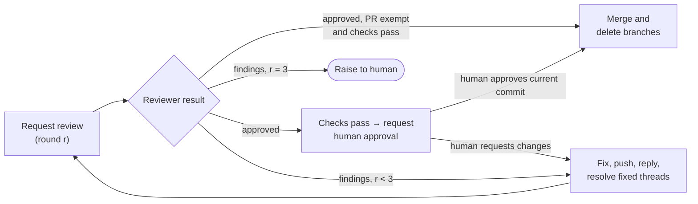

# PR review

## Contents

- [Reviewer](#reviewer)
- [Autonomy](#autonomy)
- [Project settings](#project-settings)
- [Preconditions](#preconditions)
- [Slack thread](#slack-thread)
- [The loop](#the-loop)
- [Requesting a review](#requesting-a-review)
- [Fixing the feedback](#fixing-the-feedback)
- [Human approval](#human-approval)
- [Merging](#merging)
- [Raising to the human](#raising-to-the-human)
- [Rules](#rules)

## Reviewer

The reviewer is an external tool run as its own process, separate from the author's session. Only this section and the commands in [Requesting a review](#requesting-a-review) name the tools; the rest of the skill holds for any reviewer.

The reviewers, in order of preference:

| Order | Tool | Model | Effort | Cannot run when |
| :--- | :--- | :--- | :--- | :--- |
| 1 | Codex CLI (`codex exec`) | `gpt-6.1-sol` | high | its output says `You've hit your usage limit`, or `codex` is not installed or not signed in |
| 2 | Claude Code (`claude -p`) | `opus` | high | its output says a usage limit is reached, or `claude` is not signed in |
| 3 | Antigravity CLI (`agy`) | `gemini-3.8-flash-<effort>` | high, and `high` for `xhigh` or `max`, which Flash does not have | its output says `exhausted your quota`, or `agy` is not signed in |

- **Effort.** The table's, unless the project's [settings](#project-settings) give another for the PR; the same effort for whichever tool runs the round.
- **Order.** A round runs with the first reviewer that can run it, and each round starts again from the first. The Owner decided the order on 2026-11-26 (#12, #13): Claude second, since it uses the human's Claude allowance; `agy` last, since the human's Gemini plan allows only a basic model and very little use.
- **One prompt.** Every reviewer gets the same [review prompt](#review-prompt). To change a reviewer, update this table and its command; keep the prompt as is.
- **The same capabilities.** Each reviewer may read the repository, run `gh` and read-only `git`, post as the App through `reviewer-gh.sh` and reply in Slack through `slack-post.sh`. None may edit files, commit, push or merge. The Claude and `agy` commands enforce most of that, as [Other reviewers](#other-reviewers) says. Codex's command does not yet: its workspace-write sandbox keeps it from writing outside the repository, but within it, and for merging, it rests on the prompt, until its rules are set for the reviewer's run alone (#15). What a tool's rules cannot express, such as which `gh api` calls write, rests on the prompt's "Do not edit code, commit, or push" for every reviewer.

Codex's `--approve-for-me` routes the reviewer's approval requests, such as its Slack reply, through automatic review in the workspace-write sandbox. It cannot be combined with `-s`/`--sandbox`.

## Autonomy

Creating the PR starts this skill; Claude does not ask whether to begin. Claude drives review and fixes — request, wait, fix, push, reply, resolve, re-request — autonomously. This skill is the human's standing authorisation for those pushes, comments, thread resolutions, and the Slack posts and reactions in [Slack thread](#slack-thread). Merging requires separate, explicit human approval through [Human approval](#human-approval); this skill does not authorise an automatic merge. The one exception is a PR the project's settings exempt, as [Exempt PRs](#exempt-prs) says: the project's setting is the human's standing authorisation to merge it.

- Wait for the background reviewer run's completion notification; do not poll it and do not hand back to the human while it runs.
- Pause at the [Human approval](#human-approval) gate, which is mandatory for every PR that is not [exempt](#exempt-prs), or stop for a reason listed in [Raising to the human](#raising-to-the-human). Anything else — a failing test, a finding to fix, a re-review to request — Claude handles itself.
- Report when ready for human approval, then report the final outcome: merged, changes requested, or raised. For an exempt PR, report the merge and that it needed no human approval.

## Project settings

The project's instructions (its `CLAUDE.md`, or a file it points to) give the values below; this skill holds none of them.

| Setting | What the project gives | When the project gives none |
| :--- | :--- | :--- |
| Reviewer App | The GitHub App the reviewer posts as (`<app>[bot]`), and the directory holding its `app-id` and `private-key.pem` | Review [without an App](#reviewer-identity) |
| PR channel | The Slack channel where the project's PRs are mirrored: its name and ID | No [Slack thread](#slack-thread) |
| Slack language | The language of Slack messages | English |
| Human approval | Which PRs need the human's approval before merging, and which merge on the reviewer's approval alone ([Exempt PRs](#exempt-prs)) | Every PR needs the human's approval |
| Reviewer effort | The reviewer's effort for a kind of PR, where it differs from the [Reviewer](#reviewer) table's, such as a higher one for implementation PRs | The table's effort for every PR |
| Review checks | What the reviewer checks on a kind of PR beyond the [review prompt](#review-prompt)'s own instruction, such as comparing the change with the plan it implements | None |
| Bot user | The Slack user ID of the bot account Claude and the reviewer post as | In [Exempt PRs](#exempt-prs), ask the human in the session about any Slack reply that may be theirs |

A project with its own review skill follows that skill for posting and approving, not this one; it may still borrow `slack-post.sh` and `slack-upload.sh`.

## Preconditions

- The work is committed and pushed, and the PR is open. Note its number `<N>`, its branch, and its base branch.
- The working tree is clean and on the PR branch.

### Reviewer identity

Every reviewer comment starts with the marker `**[PR review]**`, whoever posts it. How the reviewer posts and approves depends on whether the project's [settings](#project-settings) name a reviewer App:

- **With an App.** The reviewer runs every `gh` command as `~/.claude/skills/pr-review/reviewer-gh.sh <owner>/<repo> <App config directory> <gh arguments>`, which mints a one-hour token for the App with `reviewer-gh-token.sh` and runs `gh` with it, so it posts as the App. Its approval is a GitHub approving review (`gh pr review <N> --approve`). Branch protection requires that approval and dismisses it on any new push, so the reviewer's approval is enforced by GitHub, not only by this skill. Whichever tool is the reviewer, Codex or Claude, uses the App; the author session never runs the script.
- **Without an App.** The reviewer posts with the same GitHub account as Claude, so its approval is a marked PR comment, not a GitHub review: GitHub does not let an account approve its own PR.

## Slack thread

Every PR gets one Slack thread in its project's PR channel, the official place the team follows PRs. A project whose [settings](#project-settings) name no PR channel has no thread; skip this section's steps for it.

Claude and the reviewer post every message as the project's bot user, so it shows as unread to the human: `~/.claude/skills/pr-review/slack-post.sh <channel ID> [<thread ts>] < <message file>`, which takes standard Markdown and prints the message's `ts`. A file such as a screenshot goes to a thread with `~/.claude/skills/pr-review/slack-upload.sh <channel ID> <thread ts> <file> [<comment>]`; start a comment with the marker. Reading and reactions stay with the Slack tools. Sharing the bot account, their messages carry the same kind of marker as on GitHub: Claude's start with `[Claude]`, the reviewer's with `[PR review]`. Both write their Slack messages in the project's Slack language, keeping markers, `APPROVED`, links and commit SHAs unchanged. GitHub comments stay as they are.

| When | Who | What |
| :--- | :--- | :--- |
| The PR is created | Claude | Posts the main message in the channel: `[Claude] PR #<N>: <title>`, the PR link, `<branch> → <base>`, then the text of the PR description's **Summary** section in the message body. Notes its timestamp `<thread ts>`. |
| Each review round finishes | Reviewer | Replies in the thread with the round summary (see the [review prompt](#review-prompt)). |
| A round's fixes are pushed and their threads resolved | Claude | Adds a `white_check_mark` reaction to that round's summary message. |
| Ready for human approval, for a PR that needs it | Claude | Adds an `alarm_clock` reaction to the main message, then replies in the PR thread with the PR link, current head SHA, review and check results, and that merging awaits explicit human approval, given in the agent session and not in the thread. The reaction stays after the merge; the `white_check_mark` is what shows the PR merged. |
| The PR is merged | Claude | Adds a `white_check_mark` reaction to the main message. For an [exempt PR](#exempt-prs), first replies in the PR thread with the PR link, the merged head SHA, the review and check results, and that it was merged on the reviewer's approval, without human approval, as the project's settings say. |

When resuming a PR, find its main message by searching the channel for the PR link before posting; never post a second main message for the same PR. If a Slack call fails, retry once, then carry on with the review and mention the gap in the final report; Slack trouble alone never stops review or fixes, and never bypasses the human gate, which is asked for in the session whatever Slack does.

## The loop



A round is one review. At most three rounds run. A round-3 review that still has findings goes to the human, not to another fix.

## Requesting a review

Write the [review prompt](#review-prompt), filled in with round `r`, PR `<N>`, `<owner>/<repo>`, the App config directory and the Slack channel ID, `<thread ts>` and Slack language (drop the Slack paragraph for a project with no [Slack thread](#slack-thread)), to a prompt file. Keep the `[With an App]` lines for a project with a [reviewer GitHub App](#reviewer-identity) and the `[Without an App]` lines otherwise, dropping the brackets. Where the project's settings give review checks for a PR of this kind, keep the `[Project checks]` lines too, filled in with those checks in the project's own words; otherwise drop them. In round 1 keep the `[Round 1]` lines; in a later round keep the `[Later round]` lines instead, filled in with `<previous head>`, the head commit the previous round reviewed, and `<head>`, the PR's head now, which the author pushed from the checkout the reviewer runs in, so the reviewer reads what changed since then and not the whole PR again. `<previous head>` is the `commit_id` of the previous round's review (`gh api repos/{owner}/{repo}/pulls/<N>/reviews`); where that round approved without an App, so left a comment and not a review, it is the last commit pushed before that comment (`gh pr view <N> --json commits,comments`). From round 2 on, also keep the `[Earlier findings]` lines, whichever of the others are kept. A line with two tags is kept only when both apply. Where `<previous head>` is not an ancestor of `<head>` (`git merge-base --is-ancestor <previous head> <head>` fails), as after a rebase, keep the `[Round 1]` lines in place of the `[Later round]` lines: that round reviews the whole PR, and still checks the earlier findings. `<effort>` in the command is the project's reviewer effort for a PR of this kind, or the [Reviewer](#reviewer) table's. Then run the reviewer from the repository root, in the background (a high-effort review takes minutes). With Codex:

```bash
codex exec -m gpt-6.1-sol -c model_reasoning_effort='"<effort>"' --approve-for-me \
  -c sandbox_workspace_write.network_access=true \
  -o <scratchpad>/pr-review-<N>-r<r>.md - < <scratchpad>/pr-review-<N>-r<r>-prompt.md
```

When it finishes, read the output file, then confirm the outcome on GitHub: the approval exists, or the round-`r` review and its inline comments do. With an App, the approval is the App's approving review on the current head: `gh pr view <N> --json reviewDecision,latestReviews,headRefOid` shows `reviewDecision` `APPROVED` and the App's latest review `APPROVED` at `headRefOid`. Without an App, it is the approval comment. If a reviewer cannot run the round, as the [reviewer table](#reviewer) says, run the round at once with the next one, as [Other reviewers](#other-reviewers) says. If none can, run the round with the first one whose limit resets, once it resets, and tell the human which reviewer and when; never review the PR in the author's session. If the reviewer failed or posted nothing for another reason, rerun the same round once; if it fails again, raise to the human. Also read the Slack thread and note the `ts` of the round-`r` `[PR review]` reply; if it is missing, say so in the final report rather than rerunning the round.

### Other reviewers

When Codex cannot run a round, it runs with Claude Code, and when Claude cannot either, with `agy`, each with the same prompt file, from the repository root, in the background.

Claude Code:

```bash
claude -p --model opus --effort <effort> --setting-sources user \
  --allowedTools "Bash(gh *)" "Bash(git diff *)" "Bash(git log *)" "Bash(git show *)" \
    "Bash(git merge-base *)" "Bash(git rev-parse *)" "Bash(git cat-file *)" "Bash(jq *)" \
    "Bash(cat *)" "Bash(~/.claude/skills/pr-review/*)" Read Grep Glob \
  --disallowedTools "Bash(gh pr merge *)" "Bash(gh * pr merge *)" \
    "Bash(~/.claude/skills/pr-review/reviewer-gh.sh * pr merge *)" \
  --output-format text < <scratchpad>/pr-review-<N>-r<r>-prompt.md > <scratchpad>/pr-review-<N>-r<r>.md
```

`agy`, whose permission rules match each token of a command as a whole word, a token being a regular expression:

```bash
agy --model gemini-3.8-flash-<effort> --output-format text --settings '{"permissions":{
  "allow":["command(gh)","command(git diff)","command(git log)","command(git show)",
    "command(git merge-base)","command(git rev-parse)","command(git cat-file)","command(jq)",
    "command(~/.claude/skills/pr-review/reviewer-gh.sh)",
    "command(~/.claude/skills/pr-review/slack-post.sh)","read_file(*)"],
  "deny":["command(gh pr merge)","command(~/.claude/skills/pr-review/reviewer-gh.sh .* .* pr merge)",
    "write_file(*)"]}}' \
  -p="$(cat <scratchpad>/pr-review-<N>-r<r>-prompt.md)" > <scratchpad>/pr-review-<N>-r<r>.md
```

- **Separate runs, never a subagent.** Each reviewer is its own process, as Codex is, so the reviewer App's token stays in the reviewer's run. An Agent subagent of the author session would be the author reviewing, and minting the token, in its own session.
- **What they may do.** Their `git` is limited to reading history and diffs, and `gh pr merge` is denied, a deny rule taking precedence over the allow list. Claude has no file-writing tool and Claude Code refuses a shell redirection into a file. `agy`'s file-writing tools are denied; a redirection of an allowed command's output into a file is untested for it. Merging through `gh api`, or for `agy` with a global flag before `pr`, and any other write those rules cannot express, rest on the prompt, as the [Reviewer](#reviewer) section says. `--setting-sources user` leaves out the project's Claude settings, so the project's hooks do not run for the Claude reviewer.
- **Their approval counts as the reviewer's.** A round either approves is approved, as one Codex approves, for merging and for the human approval gate alike.
- **Say which reviewer ran.** Say in the Slack thread and in the [human approval](#human-approval) request which rounds Claude or `agy` reviewed. Claude is the same model family as the author and may share its blind spots; `agy` runs a basic model.
- **They use the human's allowances.** A round on a large PR is costly; the [later-round](#review-prompt) lines keep later rounds small.

### Review prompt

```text
You are reviewing GitHub PR #<N> in this repository, round <r> of at most 3.
[With an App] Run every `gh` command, including `gh api`, as
[With an App] `~/.claude/skills/pr-review/reviewer-gh.sh <owner>/<repo> <App config directory> <gh arguments>`
[With an App] in place of `gh <gh arguments>`, so you post as the reviewer App.
[Round 1] Read the PR with `gh pr view <N>` and `gh pr diff <N>`, and the surrounding code as needed.
[Later round] Read the PR with `gh pr view <N>`. The previous round reviewed commit <previous head>;
[Later round] review only what changed since then, not the whole PR again. List the PR's files with
[Later round] `gh pr diff <N> --name-only`, and read `git diff <previous head> <head> --` followed by those files;
[Later round] both commits are in this checkout. Keeping to the PR's files leaves out what a merge from
[Later round] the base branch changed in other files, but not in these: if `git log --merges <previous head>..<head>`
[Later round] lists a merge, a hunk you did not expect may be the base branch's, which `git diff <merge>^1 <merge>` shows.
[Later round] Read other code only as far as you need to judge that change and the earlier findings.
[Earlier findings] First read the earlier review comments and Claude's replies
[Earlier findings] (`gh api repos/{owner}/{repo}/pulls/<N>/comments`, `gh pr view <N> --comments`) and
[Earlier findings] check each earlier finding is fixed or convincingly answered. Threads Claude resolved
[Earlier findings] are ones it says it fixed: verify the fix, and if it is inadequate raise a new inline
[Earlier findings] comment. Threads left unresolved are ones Claude disputed: if its reasoning convinces
[Earlier findings] you, resolve the thread (GraphQL `resolveReviewThread`); otherwise reply in the thread
[Earlier findings] and keep it as a finding.

Review for correctness, security, missed requirements, and maintainability. Do not edit
code, commit, or push.
[Project checks] This project also asks, for a PR of this kind: <review checks>
[Project checks] Make each check in full, and raise each thing it finds as a finding.
[Project checks][Later round] An earlier round made them for the whole PR; in this round make them for what changed since <previous head>.

If you have findings: submit ONE review with inline comments through
`gh api repos/{owner}/{repo}/pulls/<N>/reviews` with `event: "COMMENT"` and a
`comments` array. Each comment sets `path`, `line` (and `start_line` for a range),
`side: "RIGHT"`, and a body that starts with `**[PR review]**`, cites the source
lines it is about, states the problem, and proposes the fix. The review body starts with
`**[PR review]** Round <r>:` and summarises the findings.

If you have no findings, approve with a body that is exactly
`**[PR review]** APPROVED: PR #<N> is fully reviewed and approved (round <r>).`
[With an App] Submit it as an approving review: `gh pr review <N> --approve --body '<body>'`.
[Without an App] Post it as a PR comment: `gh pr comment <N> --body '<body>'`.

Then reply in Slack by giving the reply, in a here-document, as the standard input of
`~/.claude/skills/pr-review/slack-post.sh <channel ID> <thread ts>`, never as a new channel
message and never with your Slack tools. The reply starts with
`[PR review] Round <r>:` and gives either `APPROVED` or the finding count with a one-line
summary of each finding, plus a link to the GitHub review or approval comment. Write the
reply in <Slack language>, keeping the marker, `APPROVED` and the link unchanged.

Finish by printing either `APPROVED` or `CHANGES REQUESTED: <count> findings`.
```

## Fixing the feedback

For every `**[PR review]**` inline comment of the current round:

1. Fix the cited code, or, if the finding is wrong, decide not to change it.
2. Commit the fixes (one commit per round is fine) and push to the PR branch.
3. Reply in each comment's thread
   (`gh api repos/{owner}/{repo}/pulls/<N>/comments/<id>/replies -f body=...`): the commit that fixed it, or the reasoning for not changing it. The reviewer judges that reasoning in the next round.
4. Resolve the thread of every comment that was fixed and pushed. Leave a thread Claude disputed unresolved; the reviewer resolves it if convinced.
5. Add a `white_check_mark` reaction to the round's `[PR review]` summary in the [Slack thread](#slack-thread).

Run the project's tests and checks before pushing. Then request the next round.

### Resolving threads

Review threads are resolved through GraphQL, by thread node ID. List the threads and match each to its comment by `databaseId` (the REST comment `id`):

```bash
gh api graphql -F owner=<owner> -F repo=<repo> -F n=<N> -f query='
  query($owner:String!,$repo:String!,$n:Int!){repository(owner:$owner,name:$repo){
    pullRequest(number:$n){reviewThreads(first:100){nodes{
      id isResolved comments(first:1){nodes{databaseId}}}}}}}'
```

Then resolve each fixed one:

```bash
gh api graphql -f id=<thread node id> -f query='
  mutation($id:ID!){resolveReviewThread(input:{threadId:$id}){thread{isResolved}}}'
```

## Human approval

After the reviewer approves the latest commit, confirm the PR is mergeable, its checks pass, and no review thread remains unresolved. Then present the human, in the session, with the PR link, current head commit SHA, change summary, reviewer approval link and rounds run, test/check results, and any material limitations. Ask explicitly whether to merge that PR at that commit, and pause.

The human approves only in an interactive agent session: in a message they type in the session that asked. Nothing watches for an answer elsewhere:

- Do not schedule a check, with `CronCreate` or any other way, that reads the PR's GitHub comments or its [Slack thread](#slack-thread) for an answer, and do not read them for one.
- A reply on GitHub or in Slack is not an approval, whoever posted it. Agents may share the human's account there, so a comment cannot show that the human wrote it. If the human says they answered there, ask for the approval in the session.
- The Slack thread's "ready for human approval" reply is an announcement only.

Answers count as follows:

- Accept only the human's own explicit approval for this PR and commit, given in the session after this request. Approval in response to a request that names the SHA applies to that SHA; the human need not repeat it.
- Reviewer approval, an agent's relayed claim of approval, a GitHub or Slack reply, a reaction, silence, and earlier instructions to implement or open a PR do not satisfy this gate.
- The one exception is a relay the project's own instructions accept: a named session passing on the approval the human gave in that session, under conditions they state. Accept such a relay only when it meets every one of those conditions. It applies to the commit named in the latest approval request still pending, never to a head that has changed since that request; otherwise ask again. A permission check in this session cannot see the human's approval, so where the project says the relaying session runs the merge, do not merge: check step 1 of [Merging](#merging), tell that session the PR is ready to merge at that head, and on its report of the merge do steps 3 and 4 and delete the remote branch.
- Do not enable auto-merge or merge while approval is pending. If the human requests changes, implement them, rerun checks and reviewer review within the existing three-round limit, then request fresh human approval.
- Any new head commit invalidates both reviewer and human approval. Re-review it within the three-round limit and request fresh human approval; if no rounds remain, raise to the human.

### Exempt PRs

A project's [settings](#project-settings) may say that some of its PRs merge on the reviewer's approval alone. Such a PR skips the request and the wait above: once the reviewer has approved the latest commit, go to [Merging](#merging).

- **Only what the setting names.** A PR is exempt only when the project's Human approval setting clearly covers it. A project that gives no such setting exempts nothing, and a PR the setting leaves in doubt needs the human's approval.
- **Only a setting the human has already accepted.** The setting that counts is the one on the PR's base branch, read from there (`git show origin/<base>:<file>` after a fetch), never the PR branch's copy. A PR cannot exempt itself: one that adds or changes the Human approval setting, or the file that holds it, needs the human's approval.
- **Only with a reviewer App.** A PR is exempt only where the project has a [reviewer GitHub App](#reviewer-identity), so that GitHub itself requires the reviewer's approval of the head commit. Without an App, every PR needs the human's approval.
- **Judge the head being merged.** Check the setting against the PR as it stands at that head, its whole diff against the base included (`gh pr diff <N> --name-only`), just before merging. A later push can move a PR out of the exemption.
- **The human can still step in.** If the human asks for changes or says to hold the PR, in the session or in its GitHub or Slack thread, the PR is no longer exempt: make the changes, and request the human's approval as above.
- **Read the human's replies before merging.** Nothing watches an exempt PR's threads, so just before merging read everything posted since the PR was opened: its GitHub comments and review bodies (`gh pr view <N> --comments`), its inline review comments and their replies, which that command leaves out (`gh api --paginate repos/{owner}/{repo}/pulls/<N>/comments`), and the replies in its [Slack thread](#slack-thread). This one read looks for a hold, never for an approval. A reply may be the human's when it has no `[Claude]` or `[PR review]` marker and, in Slack, is not from the project's bot user and has no "Sent using" footer. Any hold or change request from the human that is still outstanding stops the merge; if a reply leaves it in doubt, ask the human in the session and do not merge.
- **The rest of the flow holds.** The three-round limit, [Raising to the human](#raising-to-the-human) and every step of [Merging](#merging) apply unchanged. A PR raised to the human is merged only on the human's word.

## Merging

Only after both the reviewer's approval and the human's explicit approval apply to the latest commit, or, for an [exempt PR](#exempt-prs), the reviewer's approval does:

1. Check the PR is mergeable, its checks pass (`gh pr checks <N>`), with an App its `reviewDecision` is `APPROVED`, and no `**[PR review]**` thread is left unresolved. If one is, treat it as a disagreement and raise to the human.
2. Re-read the PR head SHA and confirm it matches the commit approved by both reviewer and human, or by the reviewer for an exempt PR, and that an exempt PR is still exempt at that head, with no hold from the human, as [Exempt PRs](#exempt-prs) says. Merge that exact head and delete the remote branch: `gh pr merge <N> --squash --delete-branch --match-head-commit <approved-head-sha>`. If the head changed, return to review and, where the PR needs it, human approval.
3. Switch to the base branch, pull, and delete the local branch if it still exists.
4. Add a `white_check_mark` reaction to the PR's main message in the [Slack thread](#slack-thread).

## Raising to the human

Stop and raise to the human when:

- round 3 ends without approval;
- Claude and the reviewer still disagree on a finding after Claude's reply;
- the reviewer fails twice in a row, or the PR cannot be merged (conflicts, failing checks).

The message gives the PR link, the rounds run, and each unresolved finding with the reviewer's comment and Claude's position.

## Rules

- **Drive review autonomously.** Pause for explicit human approval before merging, unless the PR is exempt, and stop for the listed escalation conditions.
- **Resolve only what was fixed.** A thread is resolved after its fix is pushed; disputed threads stay open for the reviewer.
- **Both approvals are required.** Never merge without the reviewer's approval and explicit human approval for the current commit, given in an agent session. Only a PR the project's settings exempt, in a project with a reviewer App, merges on the reviewer's approval alone.
- **The App is the reviewer's.** Only the reviewer's run uses the reviewer App's token; the author session never mints or uses it, and never approves its own PR. A clean output file alone is not approval.
- **Always squash merge.** No other merge method is used.
- **The reviewer reviews; Claude fixes.** The reviewer never edits, commits or pushes.
- **Approval is per commit.** Any push after the approval needs a new round, within the three-round limit.
- **No silent dismissal.** Every reviewer comment gets a fix or a reply.
